# Ad Speeder Extension — Technical Build Plan

Oct 28, 2026 · @Ivan

> **Transcription note.** This file is a Markdown transcription of
> `Ad Speeder Extension — Technical Build Plan.pdf`, made per section 5 ("Save this whole
> document as docs/BUILD_PLAN.md"). Symbols lost in PDF text extraction (→, ≥, ≤, Σ, ∞) were
> restored, and the directory tree and tables were rebuilt from the PDF layout. The page-11
> state-machine diagram is an image and is reproduced below as a Mermaid sketch derived from
> the 3.1 table. Wording is otherwise unchanged. If anything here disagrees with the PDF, the
> PDF wins and this file should be corrected. Ambiguities resolved with the owner are logged in
> [Resolved decisions](#resolved-decisions) at the end and marked (D1), (D2)… where they apply.

## Overview

The extension, working name **AdSpeeder**, detects an active ad on a supported platform,
pushes the page's `<video>` to the highest rate the browser accepts, mutes it, and restores
the user's exact prior state when the ad ends. It blocks no network requests, so it needs no
`declarativeNetRequest` rules and no broad host permissions beyond the target sites.

### Goals

- Detect ad start/end on YouTube within ~250 ms using layered signals, with a confidence
  model rather than a single selector.
- Never leave the user stuck at 16x or muted after an ad, even if detection fails mid-pod or
  the page navigates.
- Add a new platform with one adapter folder, one registry entry and a five-line content
  entrypoint, with zero changes to the engine.
- Ship one TypeScript codebase to Chrome, Edge, Firefox and Safari from one build command per
  target.

### Non-goals

- No request blocking, no ad element removal, no auto-clicking of "Skip" (optional later
  feature, off by default).
- No telemetry leaving the device. Statistics live in `chrome.storage.local` only.

### Constraints that shape the design

- **Max rate is not portable.** The HTML spec lets browsers reject rates outside their
  supported range by throwing `NotSupportedError`. Chromium accepts up to 16; Firefox and
  Safari differ and may silence audio well below that. The engine therefore probes a
  descending ladder (16 → 8 → 4 → 2) once per media element and caches the highest accepted
  value. Never hard-code 16.
- **Isolated vs. main world.** Content scripts run in an isolated world: they share the DOM
  (so `video.playbackRate`, classes and attributes work) but cannot see page JS objects such
  as YouTube's `movie_player` API. Player-API checks therefore run in a small optional
  MAIN-world bridge that talks to the isolated script via `window.postMessage`, and the
  extension must work without it.
- **Selectors rot.** YouTube changes its player markup often. All selectors live in one
  versioned config file per adapter, each with a fallback chain, so a breakage is a one-file
  fix.
- **Policy and terms risk.** Speeding through ads may conflict with platform terms and with
  store review policies, and platforms actively counter ad-interference tools. Review the
  Chrome Web Store, AMO, Edge and App Store policies before publishing. Netflix is the higher
  risk: its player is DRM-bound and actively monitors playback, so the Netflix adapter ships
  disabled by default behind an "experimental" toggle.

## 1. Architecture & File Structure

The codebase is TypeScript on WXT (a Vite-based extension framework), split into five layers:
entrypoints, core engine, platform adapters, shared utilities, and UI. Each layer imports only
from layers below it; adapters never import the engine, and the engine never imports an
adapter.

```
adspeeder/
├── package.json
├── tsconfig.json
├── wxt.config.ts                 # per-browser manifest generation
├── vitest.config.ts
├── playwright.config.ts
├── .github/workflows/ci.yml
├── public/
│   └── icons/                    # 16, 32, 48, 128 px + disabled variants
├── src/
│   ├── entrypoints/
│   │   ├── background.ts         # service worker / event page
│   │   ├── youtube.content.ts    # isolated-world bootstrap for YouTube
│   │   ├── netflix.content.ts    # isolated-world bootstrap for Netflix
│   │   ├── youtube-bridge.ts     # MAIN-world player-API probe (optional)
│   │   ├── popup/
│   │   │   ├── index.html
│   │   │   ├── main.ts
│   │   │   └── popup.css
│   │   └── options/
│   │       ├── index.html
│   │       ├── main.ts
│   │       └── options.css
│   ├── bootstrap.ts              # shared content-script bootstrap(id) (D2)
│   ├── core/
│   │   ├── Controller.ts         # wires adapter → state machine → engine
│   │   ├── VideoEngine.ts        # playbackRate/mute apply + restore
│   │   ├── AdStateMachine.ts     # IDLE / BOOSTING / EXIT_PENDING / CONTESTED / RESTORING (D3)
│   │   ├── RateGuard.ts          # defends against site rate resets
│   │   ├── MediaTracker.ts       # finds and re-binds the active <video>
│   │   ├── RateProbe.ts          # max-supported-rate ladder per element
│   │   ├── SessionSnapshot.ts    # saved user volume/mute/rate
│   │   └── StatsMeter.ts         # time saved + ads counted while boosting (D6)
│   ├── platforms/
│   │   ├── PlatformAdapter.ts    # interface + base class
│   │   ├── registry.ts           # hostname → adapter factory
│   │   ├── signals.ts            # Signal type + scoring helpers
│   │   ├── youtube/
│   │   │   ├── YouTubeAdapter.ts
│   │   │   ├── selectors.ts      # versioned selector chains
│   │   │   └── bridgeProtocol.ts # postMessage schema for MAIN world
│   │   ├── netflix/
│   │   │   ├── NetflixAdapter.ts
│   │   │   └── selectors.ts
│   │   └── _template/
│   │       └── TemplateAdapter.ts # copy-me skeleton for new platforms
│   ├── shared/
│   │   ├── settings.ts           # typed storage schema + defaults + migrations
│   │   ├── messaging.ts          # typed runtime messages
│   │   ├── stats.ts              # time-saved accounting
│   │   ├── logger.ts             # debug-gated logging
│   │   ├── dom.ts                # waitForElement, observeAttr, debounce
│   │   └── browser.ts            # webextension-polyfill re-export
│   └── ui/
│       ├── components.ts         # tiny vanilla UI helpers
│       └── format.ts             # duration/number formatting
├── tests/
│   ├── unit/                     # Vitest + happy-dom
│   ├── fixtures/                 # static HTML mimicking player DOM states
│   │   ├── youtube-ad-pod.html
│   │   ├── youtube-ssai.html
│   │   ├── youtube-ssai-preroll.html          # stitched pre-roll, bridge reports the URL id (D22)
│   │   ├── youtube-ssai-preroll-nobridge.html # same, no player API for the bridge to read
│   │   └── netflix-ad-break.html
│   └── e2e/                      # Playwright, extension loaded
└── safari/                       # generated Xcode project (git-ignored except config)
```

### Responsibilities by layer

| Layer                          | Owns                                                                                    | Must not                                              |
| ------------------------------ | --------------------------------------------------------------------------------------- | ----------------------------------------------------- |
| `entrypoints/*.content.ts`     | Read settings, pick adapter from registry, construct `Controller`, tear down on unload  | Contain detection or rate logic                       |
| `entrypoints/background.ts`    | Settings defaults on install, stats aggregation, badge text, message routing            | Touch the DOM                                         |
| `core/`                        | Applying/restoring media state, the ad state machine, rate defense, media node tracking | Know any platform selector                            |
| `platforms/`                   | Turning platform DOM/API facts into `AdSignal` events and supplying the `<video>`       | Set `playbackRate` or `muted`                         |
| `shared/`                      | Storage, messaging, logging, DOM helpers                                                | Import from `core/` or `platforms/`                   |
| `entrypoints/popup`, `options` | User controls and stats display                                                         | Talk to content scripts except through `messaging.ts` |

## 2. Cross-Platform Abstraction Strategy

Adapters are signal producers: each one watches its platform and emits weighted `AdSignal`s;
a shared base class scores them into a single `AdStateSnapshot`. The engine consumes snapshots
only, so it never knows which platform it is on. This is the Strategy pattern for detection
plus an Observer contract for change events.

### 2.1 The PlatformAdapter contract

```ts
// src/platforms/signals.ts
export type SegmentKind = 'ad' | 'promo' | 'recap' | 'intro';

export interface AdSignal {
  source: string; // e.g. 'yt.playerClass.ad-showing'
  active: boolean; // does this source currently indicate a segment?
  weight: number; // 0..1 contribution when active
  kind: SegmentKind;
  pod?: { index: number; total: number };
  skippable?: boolean;
  at: number; // performance.now()
}

export interface AdStateSnapshot {
  active: boolean; // after hysteresis
  kind: SegmentKind | null;
  confidence: number; // summed weight of active signals, capped at 1
  pod?: { index: number; total: number };
  reasons: string[]; // sources that fired, for debug overlay + logs
}
```

```ts
// src/platforms/PlatformAdapter.ts
export interface AdapterCapabilities {
  allowRateBoost: boolean; // false for live streams
  allowMute: boolean;
  rateEnforcement: 'none' | 'guard';
  maxRateHint?: number; // platform-known ceiling below the browser's
}

export interface AdapterContext {
  settings: Readonly<Settings>;
  log: Logger;
  signal: AbortSignal; // aborted on teardown; all listeners use it
}

export interface PlatformAdapter {
  readonly id: PlatformId;
  readonly displayName: string;
  init(ctx: AdapterContext): Promise<void>;
  isWatchContext(url: URL): boolean; // false on home/search/shorts etc.
  getVideoElement(): HTMLVideoElement | null;
  getCapabilities(): AdapterCapabilities;
  evaluateNow(): AdStateSnapshot; // synchronous re-score
  onSnapshot(cb: (s: AdStateSnapshot) => void): () => void;
  onVideoElementChange(cb: (v: HTMLVideoElement | null) => void): () => void;
  onNavigation(cb: (url: URL) => void): () => void;
  destroy(): void;
  getInteractionRoot?(): Element | null; // D14: scopes trusted-input detection; null → document
  getDiagnostics?(): AdapterDiagnostics; // selector health for logs
}

export interface AdapterDiagnostics {
  selectorsVersion: string;
  chainIndices: Record<string, number>; // chain → index that last matched; > 0 = fallback
}
```

`AdStateSnapshot` also carries `ssaiSuspected?: boolean` for the §3.4 exit rule (D7).

`BaseAdapter` (abstract) implements everything except platform facts. Subclasses implement
`protected collectSignals(): AdSignal[]`, `protected findVideo()`, `protected installWatchers()`
and call `this.invalidate()` whenever something they watch changes. `invalidate()` is coalesced
into one `queueMicrotask` re-score, so a burst of 40 mutations costs one evaluation.

**Scoring** (in `BaseAdapter`, shared by every platform) reports raw state only (D8):

- `confidence = min(1, Σ weight of active signals)`, plus `pod` and `ssaiSuspected`.
- `active = confidence ≥ enterThreshold` (default 0.6), with no delay; it is informational.
- Adapters do no exit debouncing.

**Hysteresis** has a single owner, the engine (D8, §3.1):

- Enter a segment when `confidence ≥ enterThreshold` (default 0.6).
- Leave only after `confidence ≤ exitThreshold` (default 0.2) holds for the exit debounce:
  300 ms by default, 1,000 ms while more pod ads are known to follow, 100 ms with
  `ssaiSuspected` (§3.4). This absorbs the class flicker between pod ads. Between the two
  thresholds the current state is kept.
- "Segment over" means exactly that: `confidence ≤ exitThreshold` for the full exit debounce.
- Thresholds are engine constants, overridable from the options page's debug panel.

### 2.2 Registry

```ts
// src/platforms/registry.ts
export interface AdapterDefinition {
  id: PlatformId;
  displayName: string;
  matches: string[]; // manifest match patterns, also used by the build
  defaultEnabled: boolean;
  experimental: boolean;
  create: () => PlatformAdapter;
}

export const ADAPTERS = [
  {
    id: 'youtube',
    displayName: 'YouTube',
    matches: ['*://www.youtube.com/*', '*://m.youtube.com/*', '*://music.youtube.com/*'],
    defaultEnabled: true,
    experimental: false,
    create: () => new YouTubeAdapter(),
  },
  {
    id: 'netflix',
    displayName: 'Netflix',
    matches: ['*://www.netflix.com/*'],
    defaultEnabled: false,
    experimental: true,
    create: () => new NetflixAdapter(),
  },
] as const satisfies readonly AdapterDefinition[];
```

Each content entrypoint is a stub:
`export default defineContentScript({ matches: def('youtube').matches, runAt: 'document_start', main: () => bootstrap('youtube') })`.
Content scripts are bundled as classic scripts per browser, so adapters are imported statically
per entrypoint, never with dynamic `import()`. `wxt.config.ts` derives `host_permissions` from
`ADAPTERS`, keeping one source of truth.

Adding Twitch later: copy `_template/`, implement four methods, add a registry entry, add
`twitch.content.ts`. Twitch uses server-side stitched ads, so it would reuse the SSAI
safeguards in 3.4 unchanged.

### 2.3 YouTube adapter

YouTube is detected with five independent signal families, so losing any one selector degrades
confidence instead of breaking detection.

| #   | Signal                            | How it is watched                                                                                                                                       | Weight | Notes                                                 |
| --- | --------------------------------- | ------------------------------------------------------------------------------------------------------------------------------------------------------- | ------ | ----------------------------------------------------- |
| Y1  | Player root has `ad-showing`      | MutationObserver on `#movie_player` (fallback `.html5-video-player`), `attributeFilter: ['class']`                                                      | 0.6    | Primary signal, alone crosses the enter threshold     |
| Y2  | Player root has `ad-interrupting` | Same observer                                                                                                                                           | 0.6    | Mid-roll variant; overlaps Y1                         |
| Y3  | Ad UI present and visible         | Subtree observer on `.video-ads`, `.ytp-ad-module`; checks `.ytp-ad-player-overlay`, `.ytp-ad-preview-container`, skip-button containers, ad badge text | 0.3    | Also the source of pod index/total and `skippable`    |
| Y4  | Player API says ad                | MAIN-world bridge compares the player's current video id with the URL `v` param and reads any ad-state accessor that exists                             | 0.5    | Optional; absent bridge = no signal, never a negative |
| Y5  | Media corroboration               | `loadedmetadata` / `durationchange` / `emptied` on the `<video>`; src swap or duration far below the content duration while Y1–Y4 are partly active     | 0.1    | Never enough alone; breaks ties                       |

**Selector chains.** `youtube/selectors.ts` exports `SELECTORS_VERSION` and arrays tried in
order, for example `playerRoot: ['#movie_player', '.html5-video-player']`. A health check on
each watch page logs which chain index matched and exposes it through `getDiagnostics()`. When
a watch page is left, `Controller` checks those indices; if any is > 0 for 3 consecutive watch
pages, it logs `selector-drift` with the diagnostics attached and the debug panel flags it.

**Pod parsing.** The ad badge shows text like "Ad 1 of 2" in the page's language. Parse with a
locale-agnostic regex `/(\d+)\D+(\d+)/` over the badge's `textContent`, accepting only
`1 ≤ index ≤ total ≤ 10`. Unparseable text yields no pod info, not an error.

**MAIN-world bridge (`youtube-bridge.ts`).** Registered as a content script with
`world: 'MAIN'` where supported, otherwise injected as a `<script src>` from
`web_accessible_resources`. It polls nothing; it listens for
`{ ns: 'adspeeder', type: 'probe', nonce }` messages and replies with
`{ ns, type: 'probe-result', nonce, videoId, adHint, live }`, where `videoId: string | null`,
`adHint: boolean | null` and `live: boolean | null` (D20). The isolated script validates
`event.source === window`, the namespace, a per-session nonce and the field types, and ignores
everything else. All player-API calls use optional chaining inside `try/catch`, because these
methods are undocumented and change. `null` always means "unknown", never a negative signal.

Undocumented player-API dependencies (D21), each read only by the bridge:

- `getVideoData().video_id` → `videoId` (Y4 id comparison, D22).
- `getVideoData().isLive` → `live` (context exclusions below).
- `getAdState()` → `adHint`: `1` means an ad is playing (`true`); `-1` and `0` mean no ad
  (`false`); anything else, including a missing method or a throw, is `null`.

**Server-side ad injection (SSAI) experiments.** When YouTube stitches the ad into the content
stream, there is no src swap and Y4's id comparison may not change. Detection then rests on
Y1–Y3. `ssaiSuspected` is set when Y1 or Y3 is active, there is no src change and no id
mismatch, and either:

- the content src is already known (learned after more than 1 s of ad-free playback), or
- it is not yet known (a pre-roll) but the bridge, answering during this ad segment, reports a
  `videoId` equal to the URL's `v` parameter: the ad is inside the content stream (D22).

With no bridge answer, a pre-roll whose content src is unknown is never treated as SSAI.
Two extra rules apply while `ssaiSuspected`:

- Exit uses the earliest of: Y1 cleared, Y3 overlay removed, or the ad countdown reaching 0.
  Exiting late on a stitched stream fast-forwards real content.
- A wall-clock cap forces a restore and logs `detection-lost` if the segment never ends. It
  applies to every segment, not only SSAI (D9, §3.1).

**Context exclusions.** `isWatchContext` is true only on `/watch`, `/live/` and music player
routes. On live streams (player class `ytp-live` or the bridge reports live), capabilities
return `allowRateBoost: false, allowMute: true`, because a live edge cannot be outrun. Shorts
and embeds are out of scope for v1.

**Navigation.** YouTube is an SPA. Listen for `yt-navigate-finish` on `document`, `popstate`,
and a 1 s `location.href` poll as a last-resort fallback; emit `onNavigation` once per distinct
URL.

### 2.4 Netflix adapter

Netflix ad-tier markup must be confirmed against a live ad-tier account before any selector is
trusted, so Phase 4 begins with a recorded DOM-discovery task. The adapter structure is fixed
now; the selectors are filled in from that capture.

- **Container:** observe the player root (candidates: `.watch-video`, `[data-uia="player"]`)
  with `childList + subtree + attributeFilter: ['class', 'data-uia']`.
- **Ad markers (to be confirmed):** an ad-break overlay or countdown element, likely carrying a
  `data-uia` value. Store as `selectors.adBreak` chains, weight 0.6 for the overlay, 0.3 for a
  countdown label.
- **Promo segments:** skip-intro, skip-recap and "next episode" containers (`data-uia`
  attributes) produce `kind: 'intro' | 'recap' | 'promo'` signals. The default action for these
  is `ignore`; users can choose `speed` per kind in options. Clicking Skip stays out of scope.
- **Video element:** Netflix swaps `<video>` nodes between titles; `MediaTracker` handles
  re-binding (3.5).
- **Capabilities:** `rateEnforcement: 'guard'`, `maxRateHint: 4` until testing shows the player
  tolerates more. A DRM player may stall at extreme rates; the Phase 4 checklist measures this
  before raising the hint.

## 3. Core Engine Mechanics & Safety Controls

The engine is a five-state machine driven by adapter snapshots; every exit path converges on
one idempotent `restore()`, so no failure mode can leave the user at 16x or muted.

### 3.1 State machine

| State          | Entered when                                        | Engine action                                                                                                                                                                                                                      |
| -------------- | --------------------------------------------------- | ---------------------------------------------------------------------------------------------------------------------------------------------------------------------------------------------------------------------------------- |
| `IDLE`         | Startup, or after restore                           | Nothing applied; no snapshot held                                                                                                                                                                                                  |
| `BOOSTING`     | Confidence ≥ enter threshold and capabilities allow | Take snapshot (only from `IDLE`), apply rate + mute, arm `RateGuard`                                                                                                                                                               |
| `EXIT_PENDING` | Confidence falls below exit threshold               | D25: `restoreRate()` (speed back now), keep mute, snapshot and marker; disarm `RateGuard`; start `exitDebounceMs` timer. If confidence recovers → `BOOSTING`: re-boost from the same snapshot, re-arm `RateGuard` (pod transition) |
| `CONTESTED`    | `RateGuard` budget exhausted                        | Stop rewriting rate; keep mute; still follows the exit path. Sticky for the segment (D10)                                                                                                                                          |
| `RESTORING`    | Debounce elapsed, or any force-restore trigger      | Call `restore()` (unmute; rate rewritten if a load reset it), clear snapshot + marker, verify after 500 ms, go to `IDLE`                                                                                                           |

_Engine state machine · 5 states_ (PDF p.11 diagram; sketch reconstructed from the table above):

```mermaid
stateDiagram-v2
  [*] --> IDLE
  IDLE --> BOOSTING: confidence ≥ enter threshold & capabilities allow
  BOOSTING --> EXIT_PENDING: confidence ≤ exit threshold
  EXIT_PENDING --> BOOSTING: confidence recovers (re-boost, same snapshot; CONTESTED if contested)
  BOOSTING --> CONTESTED: RateGuard budget exhausted
  CONTESTED --> RESTORING: exit path
  EXIT_PENDING --> RESTORING: debounce elapsed
  RESTORING --> IDLE: restore() + 500 ms verify
```



Pod transitions loop between `BOOSTING` and `EXIT_PENDING` without re-snapshotting; every exit
funnels into `RESTORING`. `CONTESTED` is sticky for the segment (D10): if confidence recovers
during the exit debounce of a contested segment, the machine returns to `CONTESTED`, not
`BOOSTING`, so `RateGuard` is never re-armed mid-segment, and the rate stays restored (D25).

**Two-stage exit (D25).** Leaving an ad is split so content never plays at the boost rate
while the exit is being confirmed:

1. Entering `EXIT_PENDING`: `restoreRate()` puts `playbackRate`, `defaultPlaybackRate` and
   `preservesPitch` back from the snapshot at once. `muted`, the snapshot and the crash marker
   stay. `RateGuard` is disarmed, load events no longer re-assert the rate, a settings change
   updates only the mute, and `StatsMeter` stops counting time saved. The segment cap switches
   to the muted-only limit (the rate is no longer boosted), keeping the time already spent.
2. Confidence recovers (the next pod ad): boost the rate again from the same snapshot and
   re-arm `RateGuard`, unless the segment is `CONTESTED`, which stays rate-free.
3. The exit debounce elapses: `restore()` unmutes, rewrites the rate if a load reset it during
   the debounce, clears the snapshot and the marker, and runs the 500 ms verification.

Force-restore triggers still restore everything at once.

**Segment caps (D9).** Wall-clock time is measured per segment from the moment of boosting. The
limit depends on the current mode: `maxBoostedMs` = 90 s while the rate is boosted,
`maxMutedOnlyMs` = 300 s when it is not (mute-only capability, `CONTESTED`, or a user speed
override). A mode change re-arms the cap without resetting the time already spent. When a cap
fires, the engine restores and logs `detection-lost`, and it does not re-boost until the segment
is over (§2.1). Because background tabs throttle timers, the elapsed time is also checked
against the clock on every `timeupdate` during a segment and on `visibilitychange` (D19).

**Force-restore triggers**, valid from any state: navigation, adapter `destroy`, `pagehide`,
user toggles off, platform disabled in settings, a segment cap reached, orphaned extension
context detected.

### 3.2 VideoEngine API

```ts
// src/core/VideoEngine.ts
export interface MediaSnapshot {
  playbackRate: number;
  defaultPlaybackRate: number;
  muted: boolean;
  volume: number; // recorded for verification only; never written
  preservesPitch: boolean;
  takenAt: number;
}

export class VideoEngine {
  constructor(
    private probe: RateProbe,
    private log: Logger,
  ) {}
  // D11: returns the rate that stuck; rate null = mute only (live)
  boost(v: HTMLVideoElement, opts: { rate: number | null; mute: boolean }): number | null;
  // after load events / guard; { rate: false } re-mutes only (CONTESTED)
  reassert(v: HTMLVideoElement, opts?: { rate?: boolean }): void;
  // D25 first exit stage: rate fields only; keeps mute, snapshot and marker
  restoreRate(v: HTMLVideoElement | null): boolean;
  restore(v: HTMLVideoElement | null): boolean; // full restore; idempotent, safe on detached nodes
  transfer(from: HTMLVideoElement, to: HTMLVideoElement): void; // node swap mid-ad
  isBoosted(v: HTMLVideoElement): boolean;
  appliedRate(v: HTMLVideoElement): number | null; // D11
  markUserOverride(v: HTMLVideoElement, kind: 'rate' | 'mute'): void; // D11, §3.3
  hasUserOverride(v: HTMLVideoElement, kind: 'rate' | 'mute'): boolean; // D11
}
```

**Applying a boost**

1. If no snapshot exists for this element (`WeakMap<HTMLVideoElement, MediaSnapshot>`), record
   one and write the crash marker `v.dataset.adspeederBoosted = JSON.stringify(snapshot)`
   immediately, before any media write (D12). Never snapshot while already boosted, or the
   "user state" would become 16x.
2. `target = min(settings.speed, probe.maxFor(v), capabilities.maxRateHint ?? ∞)`.
3. Set `v.muted = true` (only if `allowMute` and the user has not unmuted this segment). Leave
   `volume` untouched, so restore never has to guess it.
4. Set `v.playbackRate = target` inside `try/catch`, then read `playbackRate` back. A
   `NotSupportedError` or a read-back that doesn't match (the browser silently capped the rate)
   both count as a rejection: tell `RateProbe` to lower the ceiling and retry with the next
   ladder value until a write sticks (D5).
5. (The crash marker was already written in step 1, D12.)

**Restoring**

1. Read the snapshot (WeakMap, else the dataset marker). If none, remove any unreadable marker
   and return.
2. Restore `playbackRate`, `defaultPlaybackRate`, `preservesPitch`, then `muted`, each in its
   own `try/catch`. A rate or mute the user overrode this segment is left as the user set it.
3. Delete the snapshot and the marker, even if no media write succeeded (D12), and clear the
   segment's user overrides (D11).
4. Schedule a 500 ms verification. YouTube re-applies its own saved speed when content resumes;
   if the rate then differs from the snapshot and from 1.0, accept the site's value (it is the
   user's preference), log it, and stop. A rate of 1.0 or the segment's last boost rate is
   rewritten once.

**Restoring the rate only (D25).** `restoreRate()` runs step 2 for the rate fields alone
(`playbackRate`, `defaultPlaybackRate`, `preservesPitch`) and stops re-applying the boost rate,
so `reassert()` re-mutes but leaves the rate alone. It keeps `muted`, the snapshot and the
marker. A later `boost()` re-boosts from the same snapshot. `restore()` stays the full,
idempotent restore; after `restoreRate()` it writes the rate again only if it differs from the
snapshot (for example, a load reset to 1.0 during the debounce).

**Why also re-assert on load events.** The HTML media load algorithm resets `playbackRate` to
`defaultPlaybackRate` whenever a new source loads. Pods that swap the ad src would silently drop
to 1x, so during `BOOSTING` (only) the engine calls `reassert()` on `loadedmetadata`, `playing`
and `seeked`. It does not raise `defaultPlaybackRate`, which keeps a missed restore from persisting
across loads.

### 3.3 State preservation and user intent

- **Volume is never written**, only `muted`. The user's volume level cannot drift.
- **User unmutes during an ad:** a capturing `pointerdown`/`keydown` listener records the last
  trusted input time (D14). Input whose target is an `input`, a `textarea` or
  `[contenteditable]` is ignored. When the adapter implements `getInteractionRoot()` and it
  returns an element, only input inside that element counts; otherwise the whole document does.
  The listener sits on `document` and checks containment per event, so a root that appears late
  or is replaced by SPA navigation keeps working (D16). With a root, a trusted `keydown` on
  `<body>` or `<html>` (nothing focused) still counts when `e.key` is one of the adapter's
  `getMediaShortcutKeys()`; YouTube's are `m`, `M`, `<`, `>`; the default is none (D15). A
  `volumechange` that unmutes within 500 ms of trusted
  input marks `userOverride.mute` for the current segment; the engine stops re-muting until the
  segment ends. Restore then leaves `muted` as the user set it.
- **User changes speed during an ad:** same rule via `ratechange` → `userOverride.rate`;
  `RateGuard` stands down for that segment.
- **User's normal speed is preserved.** If they watch at 1.5x, they return to 1.5x, not a
  hard-coded 1.0.

### 3.4 Multi-ad pods and stitched streams

- Pods hold one snapshot for the whole pod. `EXIT_PENDING`'s debounce bridges the class flicker
  between Ad 1 and Ad 2. With D25 the rate steps down to the user's speed during the flicker
  and is boosted again from the same snapshot when Ad 2 is detected; the mute is held
  throughout, and the snapshot and marker are written once and removed once.
- When pod info is present and `index < total`, exit debounce extends to 1,000 ms because
  another ad is known to follow.
- A pod index increment counts as a new ad in stats; a new `<video>` node mid-pod triggers
  `transfer()` (3.5).
- With `ssaiSuspected`, the exit debounce drops to 100 ms (2.3), trading a little flicker for
  never fast-forwarding real content. The engine owns all three debounces (D8); the segment cap
  applies to every segment (D9).
- D25: in every case the speed comes back as soon as `EXIT_PENDING` starts, so the debounce
  costs at most `debounce × the user's rate` of content played muted, never a fast-forward.

### 3.5 Rate-reset defense (`RateGuard`)

The guard reasserts the target rate when the site resets it, under a strict budget so it can
never loop.

```ts
// on 'ratechange' while BOOSTING
if (v.playbackRate === target) return; // our own write echoing back
if (userInputWithin(500)) return standDown('user');
if (budget.take())
  queueReassert(backoff.next()); // 0, 50, 100, 200, 400 ms
else enter('CONTESTED'); // 10 rewrites per 5 s window
```

- Echoes of the engine's own writes are filtered by comparing against the target, not with a
  "writing" flag, because `ratechange` fires asynchronously.
- A token-bucket budget (10 rewrites per 5 s) plus exponential backoff caps the cost of a
  fighting page at a handful of writes.
- In `CONTESTED`, the extension keeps the ad muted and logs `rate-contested` with the platform
  and the adapter's `getDiagnostics()` (selector version and chain indices), which shows up in
  the options debug panel. `CONTESTED` lasts for the rest of the segment (D10), and the segment
  switches to the 300 s muted-only cap (D9).

### 3.6 SPA navigation and media node tracking (`MediaTracker`)

- `MediaTracker` asks the adapter for the current `<video>` and watches the player root with
  `childList: true, subtree: true`. When the node changes, it aborts the old element's
  listeners (one `AbortController` per binding) and binds the new one.
- If the node changes during `BOOSTING`, `engine.transfer(old, new)` restores the old element
  if still connected, moves the snapshot to the new element, and boosts it.
- When several `<video>` elements exist (previews, miniplayer), the active one is the connected
  element with the largest on-screen area and `readyState ≥ 2`, preferring one inside the
  adapter's player root (`pickActiveVideo` in `shared/dom.ts`, D13).
- On `onNavigation`: force-restore, reset the machine to `IDLE`, clear per-segment overrides,
  then call `evaluateNow()` once the adapter reports the new watch context. A pre-roll on the
  new page is detected normally.
- **Orphan detection.** After an extension update, the old content script keeps running without
  a valid runtime. Every 5 s and on each state change, `Controller` checks
  `browser.runtime?.id`; if it is gone, it restores and tears down. A newly injected instance
  that finds a `data-adspeeder-boosted` marker restores it before doing anything else.

### 3.7 Statistics

Time saved per segment = media seconds advanced − wall-clock seconds elapsed while boosted,
measured from `currentTime` and `performance.now()` deltas on `timeupdate`. Content scripts
batch `{ platform, adsSeen, secondsSaved }` to the background every 10 s and on segment end;
the background sums them into `storage.local` with daily buckets kept for 30 days.

`core/StatsMeter.ts` does the measuring while `BOOSTING` and counts each pod index increment as
a new ad; `Controller` sends the batches; `shared/stats.ts` aggregates, prunes and answers a
`getStats` message (D6).

## 4. Cross-Browser Manifest V3 & Build Pipeline

Use WXT with TypeScript: it generates a correct MV3 manifest per browser from one config,
handles the background-key differences, ships `webextension-polyfill`-style `browser` APIs, and
zips store builds. Pin the WXT version at scaffold time and commit the lockfile. If you prefer
no framework, the fallback is Vite with one Rollup input per entrypoint plus a 60-line Node
script that merges `manifest.base.json` with a per-browser overlay; the source layout in
section 1 works unchanged.

### 4.1 Base manifest (Chrome / Edge output)

```json
{
  "manifest_version": 3,
  "name": "__MSG_extName__",
  "description": "__MSG_extDescription__",
  "version": "0.1.0",
  "default_locale": "en",
  "icons": {
    "16": "icons/16.png",
    "32": "icons/32.png",
    "48": "icons/48.png",
    "128": "icons/128.png"
  },
  "action": {
    "default_popup": "popup.html",
    "default_icon": { "16": "icons/16.png", "32": "icons/32.png" }
  },
  "options_ui": { "page": "options.html", "open_in_tab": true },
  "background": { "service_worker": "background.js", "type": "module" },
  "permissions": ["storage"],
  "host_permissions": [
    "*://www.youtube.com/*",
    "*://m.youtube.com/*",
    "*://music.youtube.com/*",
    "*://www.netflix.com/*"
  ],
  "content_scripts": [
    {
      "matches": ["*://www.youtube.com/*", "*://m.youtube.com/*", "*://music.youtube.com/*"],
      "js": ["content-scripts/youtube.js"],
      "run_at": "document_start",
      "all_frames": false
    },
    {
      "matches": ["*://www.youtube.com/*", "*://m.youtube.com/*", "*://music.youtube.com/*"],
      "js": ["content-scripts/youtube-bridge.js"],
      "run_at": "document_start",
      "world": "MAIN"
    },
    {
      "matches": ["*://www.netflix.com/*"],
      "js": ["content-scripts/netflix.js"],
      "run_at": "document_idle"
    }
  ],
  "web_accessible_resources": [
    {
      "resources": ["youtube-bridge.js"],
      "matches": ["*://www.youtube.com/*", "*://m.youtube.com/*", "*://music.youtube.com/*"]
    }
  ]
}
```

Permissions stay minimal: `storage` plus the target hosts. No `tabs`, `scripting`,
`webRequest` or `declarativeNetRequest`. The badge uses
`action.setBadgeText({ tabId: sender.tab.id })`, which needs no extra permission. The Netflix
script is declared statically and exits on its first line unless the user has enabled Netflix.

### 4.2 Per-browser differences

| Concern               | Chrome / Edge                           | Firefox                                                                                                                    | Safari                                                                 |
| --------------------- | --------------------------------------- | -------------------------------------------------------------------------------------------------------------------------- | ---------------------------------------------------------------------- |
| Background            | `service_worker`                        | `background.scripts` (event page); WXT emits it                                                                            | WXT's Safari target; confirm in Xcode build                            |
| Extension ID          | Store-assigned                          | `browser_specific_settings.gecko.id` + `strict_min_version` required                                                       | Bundle identifier in the Xcode project                                 |
| `world: "MAIN"`       | Supported (Chrome 111+)                 | `strict_min_version` 140 (Android 142), which AMO's data-collection declaration needs anyway                               | Treat as unsupported; use the `<script src>` injection fallback        |
| Host permission grant | Granted at install                      | Check with `permissions.contains` at startup; popup shows a "Grant access" button calling `permissions.request` if missing | User enables per site in Safari settings; popup shows guidance         |
| Max `playbackRate`    | Probe (expect 16)                       | Probe; audio is muted anyway                                                                                               | Probe                                                                  |
| Packaging             | .zip to Chrome Web Store / Edge Add-ons | .zip + source archive to AMO                                                                                               | `xcrun safari-web-extension-converter` → Xcode app → App Store Connect |

The bridge fallback loader lives in `YouTubeAdapter` (D23), so `youtube.content.ts` stays a
one-line bootstrap. It checks for a `data-adspeeder-bridge` attribute the MAIN-world script
sets on `document.documentElement`; if absent after 1 s, it injects `youtube-bridge.js` via
`<script src="${browser.runtime.getURL('youtube-bridge.js')}">`, registered with the adapter's
`AbortSignal`.

### 4.3 Build commands

```json
"scripts": {
  "dev": "wxt",
  "dev:firefox": "wxt -b firefox --mv3",
  "build": "npm run build:chrome && npm run build:firefox && npm run build:edge",
  "build:chrome": "wxt build -b chrome",
  "build:edge": "wxt build -b edge",
  "build:firefox": "wxt build -b firefox --mv3",
  "build:safari": "wxt build -b safari && xcrun safari-web-extension-converter .output/safari-mv3 --project-location safari --app-name AdSpeeder --no-open --force",
  "zip": "wxt zip -b chrome && wxt zip -b firefox --mv3 && wxt zip -b edge",
  "typecheck": "tsc --noEmit",
  "lint": "eslint . && prettier --check .",
  "test": "vitest run",
  "test:e2e": "playwright test"
}
```

Set `manifestVersion: 3` in `wxt.config.ts` so Firefox never falls back to an MV2 build. CI
(GitHub Actions) runs typecheck, lint, unit tests, Chromium e2e and the three zips on every
push; the Safari build runs on a macOS runner on tags only.

## 5. Step-by-Step Implementation Roadmap for Claude Code

Run the six phases in order, one prompt per session or task; each ends with green `typecheck`,
`lint` and `test`, and a commit. Save this whole document as `docs/BUILD_PLAN.md` in the repo
first, so every prompt can reference sections by number.

### Phase 0 — project memory (run once)

Paste:

```text
Create CLAUDE.md at the repo root with these rules, then stop:
- Source of truth is docs/BUILD_PLAN.md; follow its section numbers.
- TypeScript strict, no `any`, ES2022, no runtime dependencies besides WXT's.
- Layering: entrypoints → core / platforms → shared. platforms/ never imports
  core/. core/ never imports platforms/*/.
- Every DOM listener and observer is registered with an AbortSignal and torn
  down on destroy.
- Every write to playbackRate or muted goes through VideoEngine. Grep must
  find no other writer.
- Selectors live only in platforms/<id>/selectors.ts.
- After each task: npm run typecheck && npm run lint && npm test. Fix
  failures before reporting done.
- Never contact live youtube.com or netflix.com in tests; use tests/fixtures.
```

### Phase 1 — Scaffold & Manifest V3 setup

```text
Read docs/BUILD_PLAN.md sections 1 and 4. Scaffold the project:
1. Initialise a WXT + TypeScript (vanilla) project named adspeeder; set
   manifestVersion: 3 and srcDir: 'src'.
2. Create the exact directory tree from section 1. Empty modules export typed
   stubs that throw 'not implemented'.
3. Write wxt.config.ts generating the manifest in 4.1, deriving
   host_permissions and content-script matches from src/platforms/registry.ts,
   and adding browser_specific_settings.gecko for Firefox.
4. Implement src/shared/settings.ts: a typed Settings schema {enabled, speed
   (default 16), mute (true), platforms: {youtube: true, netflix: false},
   promoActions: {intro, recap, promo: 'ignore'|'speed'}, debug (false),
   schemaVersion}, get/set/subscribe helpers over storage.local, and a migrate()
   function.
5. Implement src/shared/logger.ts (debug-gated, prefixed [AdSpeeder:
   <platform>]) and src/shared/messaging.ts (discriminated-union message types,
   typed send/onMessage).
6. background.ts: write defaults on install, migrate on update, route
   messages, set per-tab badge text.
7. Add package.json scripts from 4.3, ESLint + Prettier, Vitest with happy-
   dom, and a CI workflow.
Do not implement detection or the engine yet.
```

**Done when:** `npm run build` produces Chrome, Edge and Firefox outputs; each loads unpacked
with no manifest errors; the popup opens; settings unit tests cover defaults and one migration.

### Phase 2 — VideoEngine & core utilities

```text
Read docs/BUILD_PLAN.md section 3. Implement src/core/ fully:
1. RateProbe: a pure ceiling cache that never writes to the element (D5):
   WeakMap<HTMLVideoElement, number> seeded at 16; expose maxFor(v),
   lowerCeiling(v) (steps down the ladder [16, 8, 4, 2]) and the ladder.
   VideoEngine does the write-and-catch: after each write it reads
   playbackRate back, treats a mismatch like NotSupportedError, calls
   lowerCeiling and retries until a write sticks.
2. VideoEngine exactly per 3.2 (snapshot WeakMap + dataset crash marker,
   boost, reassert, restore with 500 ms verification, transfer).
3. RateGuard per 3.5 (target-echo filter, trusted-input window, token bucket
   10 per 5 s, backoff 0/50/100/200/400 ms, CONTESTED).
4. AdStateMachine per 3.1 as a pure reducer: (state, event) => [nextState,
   effects[]]. No timers inside; Controller owns timers.
5. MediaTracker per 3.6, depending only on a minimal interface
   {getVideoElement, onVideoElementChange}.
6. Controller wiring adapter snapshots → state machine → engine, including
   every force-restore trigger and orphan detection.
7. Unit tests with a FakeVideo class (settable playbackRate that can throw
   above a limit, async ratechange events) and a FakeAdapter. Cover: snapshot
   never taken while boosted; pod flicker under 300 ms keeps one snapshot; site
   reset loop ends in CONTESTED within budget; user unmute respected; navigation
   restores; detached element restore does not throw; restore returns to 1.5x
   when the user was at 1.5x.
8. Stats (D6): core/StatsMeter.ts measures, while BOOSTING, media seconds
   advanced against wall-clock seconds and counts ads (each pod index
   increment is a new ad). Controller sends batches to the background every
   10 s and when a segment ends. shared/stats.ts aggregates them into
   storage.local daily buckets, deletes buckets older than 30 days, and
   answers a getStats message. Unit-test the time-saved arithmetic, the
   batching and the pruning.
```

**Done when:** core coverage ≥ 90% lines; a grep for `playbackRate =` and `muted =` outside
`VideoEngine.ts` returns nothing.

### Phase 3 — YouTube adapter

```text
Read docs/BUILD_PLAN.md section 2.1-2.3. Implement:
1. platforms/signals.ts and BaseAdapter with signal scoring, hysteresis, and
   microtask-coalesced invalidate().
2. platforms/youtube/selectors.ts with SELECTORS_VERSION and fallback chains
   for player root, ad module, overlay, preview, skip container, badge text,
   live indicator.
3. YouTubeAdapter with signals Y1-Y5 reported raw (D8), pod parsing regex,
   ssaiSuspected rule, getInteractionRoot() returning the player root (D14),
   getDiagnostics() with SELECTORS_VERSION and chain indices,
   live-stream capabilities, isWatchContext, and navigation via yt-navigate-
   finish + popstate + 1 s href poll.
4. youtube-bridge.ts (MAIN world) and bridgeProtocol.ts with namespace +
   nonce validation; fallback <script src> injection after 1 s.
5. youtube.content.ts bootstrap.
6. Fixtures: tests/fixtures/youtube-ad-pod.html (pre-roll pod of 2 with class
   flicker), youtube-ssai.html (no src swap), youtube-live.html, and the stitched
   pre-roll pair youtube-ssai-preroll.html / youtube-ssai-preroll-nobridge.html
   (100 ms exit with the bridge, 300 ms without; D22). A tiny fixture driver script
   toggles classes and badge text on a timeline.
7. Unit tests on the adapter against fixtures; Playwright e2e that loads the
   Chromium build, serves fixtures under a youtube.com host mapping, and asserts
   rate/mute transitions and final restore.
8. tests/fixtures/rate-probe.html: plays a short local video, tries each ladder
   value and prints what was accepted, rejected or silently capped. The owner
   runs it by hand in Firefox and Safari; record results in docs/selector-log.md.
```

**Done when:** e2e shows boost within 250 ms of `ad-showing`, one snapshot across the pod,
restore within 400 ms of the last ad ending, and no boost on the live fixture. Then do a manual
check on real YouTube in Chrome and Firefox with `debug: true` and record selector-chain
indices in `docs/selector-log.md`.

### Phase 4 — Netflix adapter & extensibility

```text
Read docs/BUILD_PLAN.md section 2.4.
1. Write docs/netflix-discovery.md: a checklist and a console snippet I will
   run on an ad-tier account that logs class/data-uia changes on the player root
   during an ad break, intro and recap, and dumps them as JSON.
2. Stop and wait for me to paste that JSON.
3. Then fill platforms/netflix/selectors.ts from the capture, implement
   NetflixAdapter (ad, intro, recap, promo signals; maxRateHint 4;
   rateEnforcement 'guard'), netflix.content.ts that exits unless
   settings.platforms.netflix is true, and a fixture built from the capture.
4. Create platforms/_template/TemplateAdapter.ts with TODO comments for each
   method and docs/ADDING_A_PLATFORM.md (four steps from section 2.2).
5. Add a registry test that fails if any adapter's matches are missing from
   the generated manifest.
```

**Done when:** the Netflix fixture passes; real-account manual test confirms playback does not
stall at the chosen `maxRateHint`; the template compiles.

### Phase 5 — Popup & options UI

```text
Build the UI in vanilla TS + CSS (no framework), light and dark themes via
prefers-color-scheme.
Popup (max 320 px wide):
- Master on/off toggle; current tab status line ("Watching for ads",
  "Boosting ad 1 of 2 at 16x", "Not a supported page", "Access needed" with a
  Grant button on Firefox/Safari).
- Speed selector: 2, 4, 8, 16 (values above the probed max shown disabled
  with a tooltip).
- Mute-during-ads toggle.
- Stats: ads sped up and time saved, today and all time.
Options page:
- Per-platform enable toggles; Netflix marked Experimental with a one-line
  risk note.
- Per-kind actions for intro/recap/promo (ignore | speed).
- Debug panel: debug logging toggle, thresholds, last 50 events (state
  transitions, contested, detection-lost, selector drift), export as JSON.
- Reset stats; reset all settings.
Live status comes from content scripts via messaging.ts; stats from
background.
Add unit tests for formatting and settings round-trips.
```

**Done when:** every control round-trips through storage and takes effect in an open tab within
1 s without reload; keyboard-only operation works; contrast passes WCAG AA.

### Phase 6 — Hardening, testing & packaging

```text
1. Edge-case tests (unit or e2e): extension disabled mid-ad; extension
   reloaded mid-ad (orphan path + crash marker); tab hidden during ad; seek
   during ad; video element replaced mid-pod; user presses speed keys during an
   ad; maxBoostedMs cap; settings speed above probed max.
2. Performance: assert at most one evaluation per animation frame under a
   500-mutation burst; no observer on document.body subtree.
3. Run Firefox e2e via web-ext + Playwright Firefox where supported;
   otherwise a documented manual script.
4. Generate Safari project with npm run build:safari; document signing steps
   in docs/RELEASE.md.
5. Add _locales/en/messages.json, store listing copy, privacy statement (no
   data collected, all local), and a CHANGELOG.
6. Produce zips with npm run zip and a source archive for AMO.
```

**Done when:** the release checklist in the appendix is fully ticked.

## Appendix: Testing, Selector Maintenance & Release

### Test matrix

| Scenario                                   | Unit | Fixture e2e (Chromium) | Manual (Chrome, Firefox, Edge, Safari) |
| ------------------------------------------ | ---- | ---------------------- | -------------------------------------- |
| Single pre-roll                            | Yes  | Yes                    | Yes                                    |
| Pod of 2–3 with class flicker              | Yes  | Yes                    | Yes                                    |
| Mid-roll during content at user speed 1.5x | Yes  | Yes                    | Yes                                    |
| Stitched (SSAI) ad, no src swap            | Yes  | Yes                    | When observed                          |
| Live stream mid-roll (mute only)           | Yes  | Yes                    | Yes                                    |
| Site resets rate repeatedly                | Yes  | Yes                    | --                                     |
| User unmutes or changes speed during ad    | Yes  | Yes                    | Yes                                    |
| SPA navigation mid-ad                      | Yes  | Yes                    | Yes                                    |
| `<video>` replaced mid-pod                 | Yes  | Yes                    | --                                     |
| Extension disabled / reloaded mid-ad       | Yes  | Yes                    | Yes                                    |
| Netflix ad break, intro, recap             | Yes  | Yes                    | Ad-tier account only                   |

### Selector maintenance

- Bump `SELECTORS_VERSION` on every selector change and note it in `CHANGELOG.md`.
- The debug panel's "selector drift" and `detection-lost` events are the early warning; check
  them weekly on a test profile.
- A breakage fix should touch only `platforms/<id>/selectors.ts` and its fixture. If it needs
  engine changes, the abstraction has leaked; fix that instead.

### Release checklist

- [ ] `typecheck`, `lint`, unit and e2e green in CI
- [ ] Manual matrix run on all four browsers, results in `docs/selector-log.md`
- [ ] No `playbackRate` / `muted` writes outside `VideoEngine.ts`
- [ ] Permissions are exactly `storage` + target hosts
- [ ] Netflix ships disabled and labelled Experimental
- [ ] Store policies reviewed for Chrome Web Store, Edge Add-ons, AMO and App Store
- [ ] Privacy statement: no data leaves the device
- [ ] Version bumped in `package.json`; zips and AMO source archive built
- [ ] Safari app signed and submitted via App Store Connect

## Resolved decisions

Places where the plan was ambiguous or self-contradictory, resolved with the owner on
2026-10-28. They override the text above where they conflict.

- **D1 — Bridge output path.** §4.1 listed the MAIN-world content script as
  `content-scripts/youtube-bridge.js`, while its `web_accessible_resources` entry, the §4.2
  loader and the §1 file name all point to a root `youtube-bridge.js`. Decision: build one root
  `youtube-bridge.js` (from `src/entrypoints/youtube-bridge.ts`, a WXT unlisted script) and
  reference it from both the `world: "MAIN"` content-script entry and
  `web_accessible_resources`.
- **D2 — Where `bootstrap(id)` lives.** §2.2 calls `bootstrap('youtube')` without naming its
  file. It needs both the registry and the Controller, so it can't live in `core/` or
  `platforms/`, and WXT treats every file in `entrypoints/` as an entrypoint. Decision:
  `src/bootstrap.ts`, at the entrypoint layer.
- **D3 — State names.** The §1 tree comment said `IDLE / AD_ACTIVE / AD_TRANSITION / RESTORING`;
  §3.1 defines five states. Decision: §3.1's
  `IDLE / BOOSTING / EXIT_PENDING / CONTESTED / RESTORING` (tree comment corrected).
- **D4 — Netflix `run_at`.** §2.2's example stub uses `document_start`; §4.1 gives Netflix
  `document_idle`. Decision: `document_idle`, per §4.1.
- **D5 — RateProbe vs. VideoEngine-only writes.** Probing a rate needs a `playbackRate` write,
  which only `VideoEngine.ts` may do. Decision: `RateProbe` is a pure ceiling cache
  (`WeakMap<HTMLVideoElement, number>` seeded at 16; `maxFor`, `lowerCeiling`, the ladder) and
  never touches the element. `VideoEngine` writes, reads `playbackRate` back, treats a
  mismatch like `NotSupportedError` (the browser silently capped it), lowers the ceiling and
  retries until a write sticks. §3.2 step 4 and Phase 2 item 1 updated.
- **D6 — Stats move into Phase 2 (item 8).** No phase owned §3.7. Decision: `core/StatsMeter.ts`
  measures while `BOOSTING` (pod index increments count as new ads); `Controller` sends
  batches every 10 s and on segment end; `shared/stats.ts` aggregates into daily
  `storage.local` buckets, prunes buckets older than 30 days and answers a `getStats` message.
  Unit tests cover the arithmetic, batching and pruning.
- **§4.2 Firefox `world: "MAIN"` row** now states `strict_min_version` 140 (Android 142), as
  shipped in Phase 1.
- **D7 — `ssaiSuspected` on `AdStateSnapshot`.** §3.4's 100 ms exit rule needs it, and the
  snapshot is the only channel from adapter to engine. Optional boolean (§2.1).
- **D8 — Single owner for hysteresis: the engine.** Adapters report raw state only:
  `confidence`, `pod`, `ssaiSuspected`, and `active = confidence ≥ enterThreshold` with no
  delay. The engine owns the enter threshold, the exit threshold and the 300 / 1,000 / 100 ms
  exit timers. "Segment over" = `confidence ≤ exitThreshold` for the full exit debounce. (§2.1,
  §3.1, §3.4)
- **D9 — Segment caps by mode.** Wall-clock time per segment; `maxBoostedMs` 90 s while the rate
  is boosted, `maxMutedOnlyMs` 300 s when it isn't (mute-only capability, `CONTESTED`, user
  speed override). Either cap restores, logs `detection-lost`, and blocks re-boosting until the
  segment is over. Armed for every segment, not only SSAI. (§3.1)
- **D10 — `CONTESTED` is sticky for the segment.** Recovery from `EXIT_PENDING` returns to
  `CONTESTED`, never re-arming `RateGuard` mid-segment. (§3.1, §3.5)
- **D11 — VideoEngine API additions.** `boost()` returns the rate that stuck and accepts
  `rate: null` (mute only); `reassert(v, { rate: false })`; `appliedRate`, `markUserOverride`,
  `hasUserOverride`. User overrides are cleared on restore. (§3.2)
- **D12 — Crash marker at snapshot time.** Written before any media write; `restore()` removes
  it even when no media write succeeded, and removes unreadable markers. (§3.2)
- **D13 — `pickActiveVideo` lives in `shared/dom.ts`.** Adapters call it from `findVideo()`, and
  `platforms/` may not import `core/`. (§3.6)
- **D14 — Trusted-input guard.** Input targeting `input`, `textarea` or `[contenteditable]` is
  ignored. Optional `PlatformAdapter.getInteractionRoot()` scopes detection to that element
  (YouTube returns its player root in Phase 3); without it, the whole document counts. (§3.3)
- **Diagnostics.** Optional `PlatformAdapter.getDiagnostics()` returns
  `{ selectorsVersion, chainIndices }`; `Controller` attaches it to `rate-contested`,
  `detection-lost` and `selector-drift` logs and runs the 3-page drift rule (§2.3).
  `SELECTORS_VERSION` is a string. YouTube implements it in Phase 3.
- **Real speed limits.** Phase 3 adds `tests/fixtures/rate-probe.html` (item 8) for manual runs
  in Firefox and Safari; results go in `docs/selector-log.md`.
- **D15 — Page-wide media shortcuts.** With an interaction root, a trusted `keydown` whose target
  is `<body>` or `<html>` counts as user input only if `e.key` is in the adapter's optional
  `getMediaShortcutKeys()` (default: none). YouTube's constant is `m`, `M`, `<`, `>`. Inside the
  root any key counts. Space and `k` on `<body>` do not count. (§3.3)
- **D16 — Interaction root checked per event.** The capture listener stays on `document` and
  accepts an event only if its target is inside `getInteractionRoot()`, so a late or replaced
  root keeps working. (§3.3)
- **D17 — Selector drift counted by `Controller`.** Each watch page is checked as it is left,
  using `getDiagnostics()`; 3 consecutive pages with any chain index > 0 log `selector-drift`.
  (§2.3)
- **D18 — A user speed override counts as "rate not boosted"** and moves the segment to the
  300 s muted-only cap. (§3.1)
- **D19 — Cap check survives timer throttling.** Elapsed time is clock-based; besides the timer,
  the cap is checked on every `timeupdate` during a segment and on `visibilitychange`. (§3.1)
- **D20 — Bridge reports live.** `probe-result` carries `live: boolean | null`, read from
  `getVideoData().isLive`; `true` turns off the rate boost like `ytp-live`. (§2.3)
- **D21 — `getAdState()` is an undocumented dependency.** `1` means ad; `-1`/`0` mean no ad;
  anything else is unknown (`null`). Listed with the other player-API reads in §2.3.
- **D22 — Stitched pre-roll via the bridge.** SSAI is suspected from a known content src, or,
  before it is known, when Y1 or Y3 is active and the bridge (answering during the segment)
  reports the URL's own `v` as the video id. With no bridge, a pre-roll is not SSAI. Fixture
  pair: 100 ms exit at countdown 0 with the bridge, 300 ms after `ad-showing` clears without.
  (§2.3, §3.4)
- **D23 — Bridge fallback loader in `YouTubeAdapter`**, not `youtube.content.ts`, so the
  entrypoint stays a bootstrap and the loader shares the adapter's `AbortSignal`. (§4.2)
- **D24 — Manual-run log.** `docs/selector-log.md` has a "Manual run" table: date, browser,
  scenario (pre-roll / pod / mid-roll / skippable / live / navigate mid-ad), boost started,
  restore clean, chain indices, events (contested / detection-lost / drift), notes. (Appendix)
- **D25 — Two-stage exit.** Speed comes back immediately; mute stays until the exit is
  confirmed. Entering `EXIT_PENDING` calls `VideoEngine.restoreRate(v)` (rate fields only),
  keeps mute, snapshot and marker, disarms `RateGuard`, and pauses `StatsMeter`. Recovery
  re-boosts from the same snapshot and re-arms the guard, unless `CONTESTED` (stays rate-free).
  The elapsed debounce runs the full `restore()` and the 500 ms verification. Force-restores
  still restore everything at once. (§3.1, §3.2, §3.4) e2e: content advanced between the exit
  and the full restore must be ≤ debounce × 1.0 + 50 ms. The SSAI check adds a named Chromium
  allowance of 1.0 s of media: after a rate drop from 16x, Chromium's clock stalls about 30 ms
  and then jumps 0.55–0.83 s while queued 16x audio drains, which the extension can't prevent.
